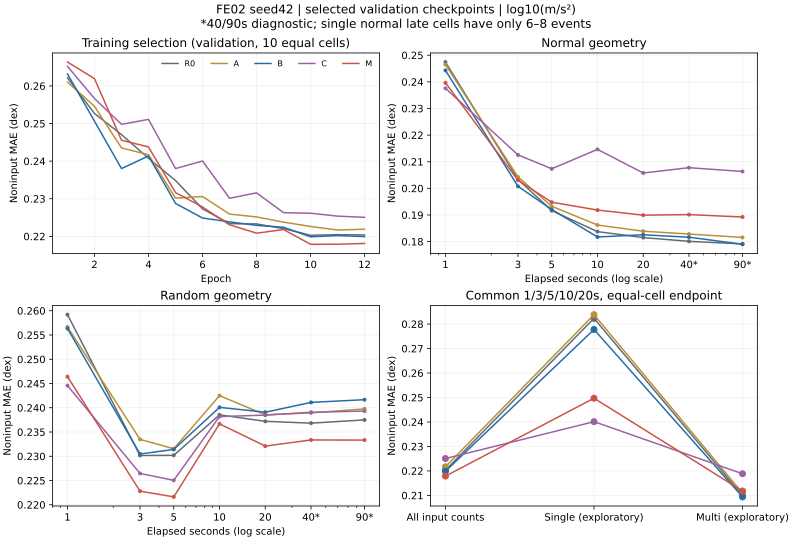
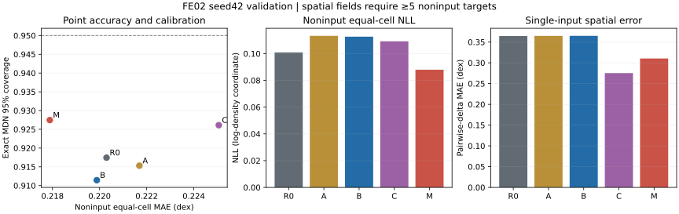

# FE02 真实结果提取与 Codex 独立分析（2026-11-04）

五组 seed42 均已有完整 12 轮记录和固定 validation 导出。M 的主指标最低，
但与 B 的配对差异区间包含零；收益主要在 random 和单台条件，normal 多台存在代价。
这是单 seed、已用于选择 checkpoint 的 validation 证据，尚不能宣称稳健架构优胜。

仓库 `rular099/team_pytorch`；分支 `exp/fe02-event-fusion-readout`；
分析基点 `42b3d5405d9fe9672f0a0925275ca4f7e9e6a9e7`。
真实运行记录的训练源码为 `9f70371838ec31044e559096a939f023d2924f37`。
本次只读取用户提供的 `fe02_runs_20261008`，进行本地统计、验证和 Git 交接。
原目录未改写，未提交新超算任务或执行模型推理。

## 可核验的当前状态

2026-11-03 接手报告依据的是截至 10 月 14 日已同步到 GitHub 的证据。
这批本地产物补齐了之后的训练、评价和恢复回执，故“只有 M 前五轮、其他组 UNKNOWN”
已不适用于本批结果；原接手报告作为历史输入保留，不原地改写。

| variant | 记录轮数 / 累计更新 | validation 所选 epoch | 最终训练/评价 JobID |
| --- | --- | --- | --- |
| R0 | 12 / 2544 | 10 | 31088392 |
| A | 12 / 2544 | 11 | 31088387 |
| B | 12 / 2544 | 10 | 31088360 |
| C | 12 / 2544 | 12 | 31088347 |
| M | 12 / 2544 | 10 | 30961700 |

来源：[runs_manifest.csv](data/runs_manifest.csv)、[训练曲线](data/training_curves.csv)、
[带原日志行号的证据](data/slurm_evidence_excerpts.json)。五个最终 `.out` 均含训练及
normal/random validation 完成信息；**未提供 sacct，不能据此填写调度器 State=COMPLETED/ExitCode=0**。

本批共 464 个源文件、4,086,853,399 bytes，逐文件 SHA256 见
[source_artifacts.csv](data/source_artifacts.csv)。完整预测、每轮 validation、NPZ 保留在外部；
Git 中只放轻量派生表、可移植审计及配置副本、复算脚本和图。

## 协议、人口与来源核验

- 固定 DiTing MAE1200M encoder；五组 encoder checkpoint SHA256 均为
  `c71aea36cd3b14a3dfa8da1b22104776bede4c04e208db01b443ae25c27a685b`。
  各组真实冻结/梯度、因果边界和查询独立性 audit 记录 PASS。
- 从原源码包重建 115 个 backend 文件与 42 个 FE02 文件的复合身份，得到
  `b802b5d74aa6d4235015074ed1b6dccb1c29c7d9573a8634443631ab0e21324b`，
  与五组锁一致；当前本地受审计的 92 个科研源码文件与包内记录一致。
  原源码包成员字节也逐一对照其清单。见 [source_verification.json](data/source_verification.json)。
- 全组同 split、cohort、25 个年度 shard 记录、train-only normalization、训练预算、
  未改动下游初始化与 adapter 初始化。train cohort 9,084 events，validation 1,310 events。
  初始 split 中有 616 个 train/val 事件因预定支持条件排除，不能混用原始元数据总人数。
- 每轮计划 27,252 次事件抽样、实际 27,136、为等更新预算丢弃 116；有效 batch128。
  这些是记录值；未提供 committed sample journals，不能认证真实时刻/几何采样频率。
- 每组完整固定评价为 1/3/5/10/20/40/90 秒 × normal/random，18,340 个事件决策、
  268,381 条目标记录，support status 全部 supported。主域只用前五时刻：
  all-target 194,265，noninput 139,440，observed-input 54,825。
- 全部逐目标的身份、真值、输入 IDs/坐标及可用的截断/存储 mask 元数据跨组一致；
  主域 query 计划与各组事先锁定的 audit population 一致。没有原始波形/mask 张量，
  不能把元数据一致扩大成独立重放认证。
- 从 60 份每轮 validation CSV 重算选择分数；与曲线一致。所选 epoch 与最终导出
  provenance 一致。独立导出与选中轮预测存在浮点级差异，逐组实测值保存在
  [verification.json](data/verification.json)，采用原 query audit 的 atol=rtol=1e-5 核验。
  **下文全部成绩使用最终 evaluation_fixed_val 导出。**
- 从完整逐目标记录重建原指标 CSV；每组另按确定性索引抽取 512 条 MDN，独立重算
  mixture mean、NLL、CRPS、Brier、sigma 及区间覆盖，均相符。
  这不是对所有 MDN 分量的独立重评分；[样本](data/mdn_scoring_sample.csv)供复核。

所有 PGA 坐标是 **log10(m/s²)**。预测为 MDN 在该坐标下的 mixture mean；
MAE/RMSE/偏差/空间误差单位为 dex；不将 log-space mean 当成物理 PGA 的算术均值。
详细 split/cohort、有效配置、原 checkpoint SHA 记录见 [data/](data/) 下各表和
[evidence/](data/evidence/)。可移植 JSON 替换了部署路径并将重复 cohort 列表指向公共 CSV，
其字节 SHA 不冒充原文件 SHA；原文件 SHA 保留在源索引中。副本供审阅，不直接用于恢复训练。

## 主结果：精度、目标角色与校准

表中每行均为 seed42、validation、normal/random × 1/3/5/10/20秒十 cell 等权。
每个 cell 内先按目标求均值，再等权汇总；equal-cell RMSE 为各 cell MSE 均值开方。
所有组各有 1,310 events，noninput 139,440 targets，all 194,265 targets。

| variant / epoch | noninput MAE | noninput RMSE | all-target MAE | noninput NLL | Brier | 95% coverage | 68.27% coverage |
| --- | ---: | ---: | ---: | ---: | ---: | ---: | ---: |
| R0 / 10 | 0.220296 | 0.292521 | 0.211204 | 0.100931 | 0.167802 | 0.917440 | 0.616941 |
| A / 11 | 0.221691 | 0.294994 | 0.210450 | 0.113290 | 0.168966 | 0.915297 | 0.613436 |
| B / 10 | 0.219883 | 0.292619 | 0.208864 | 0.112664 | 0.168687 | 0.911439 | 0.611653 |
| C / 12 | 0.225063 | 0.299360 | 0.222402 | 0.109254 | 0.168811 | 0.926105 | 0.640080 |
| M / 10 | 0.217888 | 0.289210 | 0.206376 | 0.087987 | 0.165935 | 0.927459 | 0.629179 |

来源：[endpoints.csv](data/endpoints.csv)，筛选主域、all_counts、equal_normal_random。
NLL 为 log10 PGA 密度坐标上的负自然对数密度；Brier 为超过 `-1.2 log10(m/s²)` 的概率评分。
覆盖率取精确 MDN 的 `[q.025,q.975]` 和 `[q.158655,q.841345]`，不同于 mean±sigma。

M 的点误差、NLL、CRPS/Brier 和覆盖率方向一致改善，但仍欠覆盖；不能称“已校准”。
noninput 等 cell 的 predictive sigma 为 R0 0.246125、M 0.250578 dex，95%区间宽度
R0 0.966098、M 0.987886 dex：M 同时略宽。上述人口、epoch 和来源同主表。

同一主域 noninput 的 **target-pooled** R² 为 R0 0.445193、M 0.466235，
prediction-on-truth slope 为 0.477690、0.489406，bias 为 -0.008658、-0.015600 dex。
这些不与主表等 cell 加权混称；动态范围压缩和 M 的负偏差仍然存在。
全组的 pooled R²/bias/双向 slope、各目标角色及 40/90 秒独立诊断均在 endpoints 和
[分时/几何/台站数/目标角色表](data/metrics_time_geometry_count_target.csv)中。
A 的 all-target MAE 改善但 noninput 未改善，说明仅看 all-target 会改变解读。



## 配对比较：M 的总体收益有限，单台/多台不一致

以下差值为 competitor − baseline，负值表示 competitor 较好。
同一主域/seed/epoch/目标人口如主表，5000 次 event-cluster bootstrap、seed20261008，
每次在事件层抽样并重算十 cell 等权指标；95% percentile CI，未做多重比较校正。
七项预定对照完整保留，未因结果重新挑对照。

| 对照 | Δ noninput MAE (dex) | 95% CI | events / targets |
| --- | ---: | --- | --- |
| R0→A | +0.001395 | [-0.000105, +0.002908] | 1310 / 139440 |
| A→B | -0.001807 | [-0.003238, -0.000419] | 1310 / 139440 |
| B→C | +0.005179 | [+0.001751, +0.008667] | 1310 / 139440 |
| M→C | +0.007175 | [+0.004000, +0.010328] | 1310 / 139440 |
| A→M | -0.003802 | [-0.006138, -0.001513] | 1310 / 139440 |
| B→M | -0.001995 | [-0.004281, +0.000317] | 1310 / 139440 |
| R0→M | -0.002408 | [-0.004637, -0.000192] | 1310 / 139440 |

来源：[paired_event_bootstrap.csv](data/paired_event_bootstrap.csv)。M 对 R0 的主 MAE
相对下降约 1.09%；区间贴近零，且没有覆盖种子和 checkpoint 选择的不确定性。
这些 CI 条件于本次已选 checkpoint，并未提供独立测试集泛化推断。

同一主域的探索性输入数分层：single 为 660 events / 28,535 noninput targets；
multi 为 1,219 events / 110,905 targets。同一事件可以出现在不同时间的两层，人数不可相加。

| variant / epoch | single 等 cell MAE | multi 等 cell MAE |
| --- | ---: | ---: |
| R0 / 10 | 0.282333 | 0.209966 |
| A / 11 | 0.283838 | 0.210909 |
| B / 10 | 0.277784 | 0.209393 |
| C / 12 | 0.240129 | 0.218834 |
| M / 10 | 0.249697 | 0.211798 |

M 对 R0 single 差值 -0.032636，CI [-0.044746,-0.020266] dex；
multi 差值 +0.001832，CI [-0.000428,+0.004074] dex。
M 对 B 的 normal-all 差值 +0.003564，CI [+0.000150,+0.006841]
（1292 events / 56490 targets），random-all 差值 -0.007555，
CI [-0.010242,-0.005109]（1310 / 82950）。总体均值不能掩盖这一取舍。

**单台晚时刻极稀疏：** normal 的 5/10/20秒分别仅 26/8/6 events、46/15/13 noninput targets。
single normal 与合并几何 bootstrap 各有 12/5000 次抽样出现空 cell，原实现将这些重复
从等 cell CI 中排除；已保留该分母。random single 各 cell 为 660/342/290/288/288 events，
M 对 R0 的 random-single 差值仍为 -0.023997，CI [-0.031146,-0.017093] dex
（660 events / 22989 targets），所以单台收益有较充分的 random 层证据。
C 对 M 在 random-single 几乎相同：C−M +0.000282，CI [-0.005336,+0.005882] dex，
同为 660 / 22989；不能用合并 single 排名断言 C 稳健胜出。

## 单台空间场：范围与误差一起改善

本表使用相同 seed42/validation/所选 epoch、共同前五时刻及两种 geometry，
只取 single 且至少 5 个非输入目标的场：每组 410 distinct events、1,413 fields、
26,381 target appearances；所有这些场的真值 P95−P05≥0.05 dex，range ratio 均可计算。
centered/pairwise 为 **每个场先计算，再对 1,413 场作宏平均**；ratio 列为场中位数。
同一事件多时刻的场相关，这些是描述统计，未声称有空间指标显著性检验。

| variant / epoch | centered MAE (dex) | pairwise-delta MAE (dex) | P95−P05 预测/真值范围比中位数 |
| --- | ---: | ---: | ---: |
| R0 / 10 | 0.234567 | 0.341279 | 0.014504 |
| A / 11 | 0.235088 | 0.342017 | 0.008937 |
| B / 10 | 0.235108 | 0.342030 | 0.008897 |
| C / 12 | 0.187796 | 0.275774 | 0.538344 |
| M / 10 | 0.197849 | 0.289588 | 0.478253 |

来源：[primary_spatial_fields.csv](data/primary_spatial_fields.csv)，筛选 input_count=1。
centered MAE 去除同场均值；pairwise-delta MAE 比较场内各查询对的预测差与真值差。
**B 的后置事件加法几乎未改变单台空间对比这一现象**可从描述值看出，
但未计算空间 CI，不能将此处“没有明显变化”写成统计学不显著。
M 与 C 的范围、centered 及 pairwise 误差共同改善，故不只是“范围变大”。

空间子人口比点指标人口更窄；其中 normal 10秒和20秒各仅 1 field / 1 event / 6 targets。
因此不要把十个 cell 的空间均值当成精确的总体估计。
图右面板使用已有 cell 等权，具体分母见
[spatial_summary_by_cell.csv](data/spatial_summary_by_cell.csv)，与本表 field-macro 权重有别。



## 独立解释、尚缺证据及建议

**推断：** R0/A/B 的单台空间范围接近零，A 的非线性和 B 的后置事件融合没有充分恢复
查询依赖的空间变化。M 在 attention 内加入事件 memory、C 绕过 PGA attention 后均有所缓解，
与原研究假设相容。这个对照尚不能单独隔离所有机制：新增参数、事件与查询的结合方式、
C 不同的活跃计算容量都存在差异；M 的事件 token 也不增加独立观测。
没有 attention 导出或干预证据，不能声称证明某个 attention 层是唯一原因。

**来源缺口：** 本批无 init/last/best checkpoint 字节、无 committed training journals、无 sacct。
checkpoint epoch/SHA 是导出记录，经同轮选择和逐目标元数据相互核验，但未直接加载权重重验。
160 份 RNG 恢复回执覆盖 10 次作业、每次 rank0–15；兼容层 SHA 与仓库一致。
最后 R0/A/B/C 的 launcher SHA 各不相同且与仓库入口不同，M 一致；四份 launcher 原始字节
未提供，不能仅凭兼容层和训练锁一致就认证入口只改了分组。详见
[rng_receipt_jobs.csv](data/rng_receipt_jobs.csv) 及完整回执。

**建议（未执行）：** ChatGPT 先独立复核本包的角色/几何/输入数分层、来源缺口和 CI 定义。
若用户需要下一轮实验决策，先补齐 launcher/权重元数据/sacct；再商定多 seed 与独立评价，
重点检查 single 收益是否能保留且 normal multi 代价是否可接受。
本轮不建议据此更改 RT55 或在 held-out test 上筛选架构。预训练语料重叠、在线因果认证、
未见台站泛化均未由本批结果解决。

## 复算与审阅入口

优先读 [CHATGPT_ANALYSIS_PROMPT.md](CHATGPT_ANALYSIS_PROMPT.md)、
[verification.json](data/verification.json)、主指标和配对表。
本包 compact event 表足以重建全部五组主分数及 63 行 bootstrap（含 pooled 和等 cell CI）：

```bash
conda run -n general python reports/fe02_hpc_results_20261104/verify_summary.py
conda run -n general python reports/fe02_hpc_results_20261104/plot_report.py
```

从原始结果完全重建时，先指定外部目录和全新的中间目录；在仓库根目录执行：

```bash
export FE02_RESULTS_ROOT='<用户提供的原始结果目录>'
export FE02_COMPARE_OUT='<不存在的本地中间目录>'
python - <<'PY'
import os
from pathlib import Path
from fe02.analysis import compare
root=Path(os.environ['FE02_RESULTS_ROOT'])
compare([root/f'fe02__formal__{v}__seed42/evaluation_fixed_val'
         for v in ('R0','A','B','C','M')], os.environ['FE02_COMPARE_OUT'])
PY
python reports/fe02_hpc_results_20261104/build_report.py \
  --root "$FE02_RESULTS_ROOT" --comparison "$FE02_COMPARE_OUT" \
  --output '<新的本地证据目录>'
```

本次统计环境：general，NumPy2.5.4 / pandas3.1.0 / SciPy1.18.1；非原 HPC 的 PyTorch/ROCm 环境。
原未修改的 `tests.test_fe02_analysis` 两项通过；`compact_verification.json` 记录独立复算结果。
图只从本包 CSV 生成，不使用另行挑选的个例、阈值或测试集。
