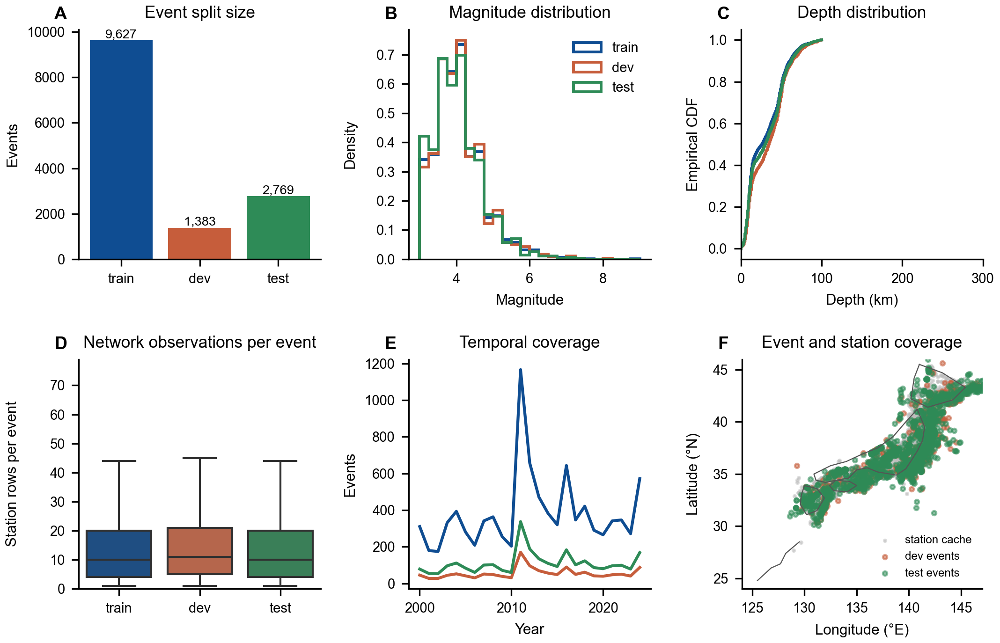
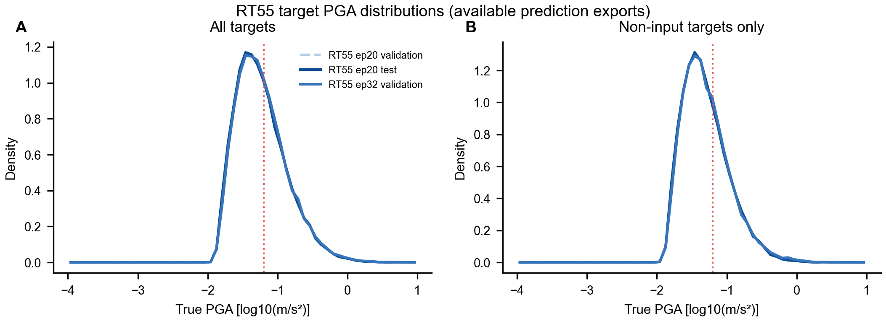
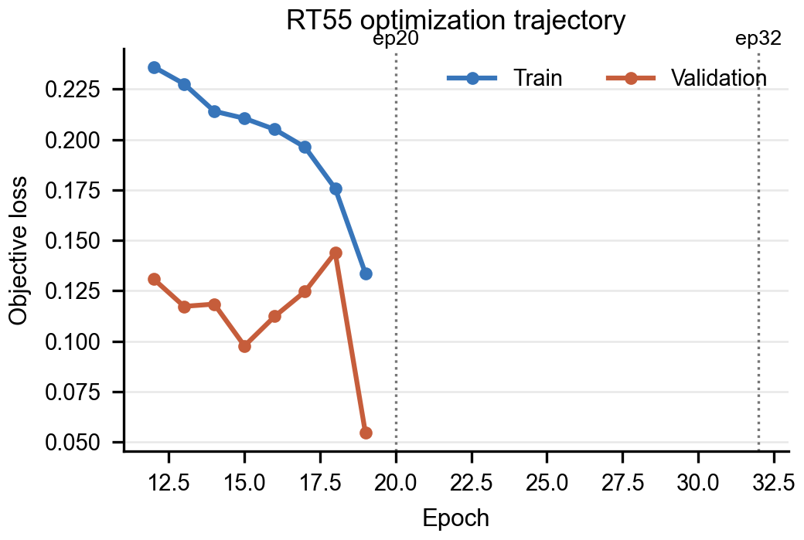
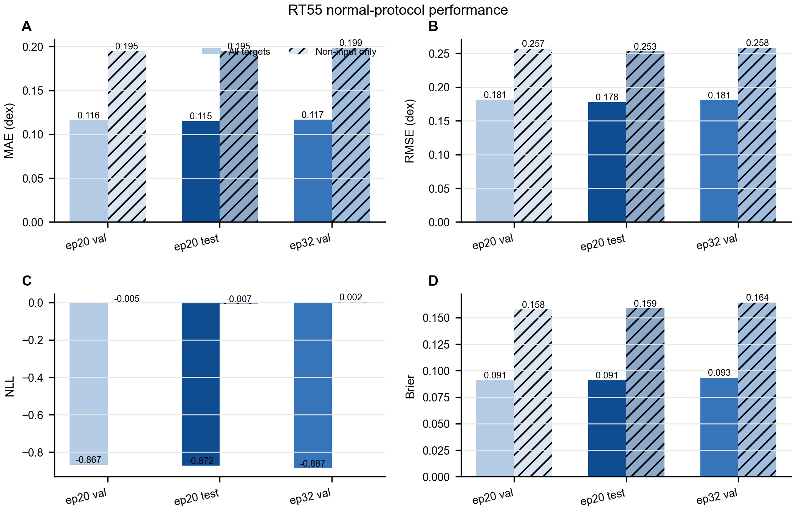
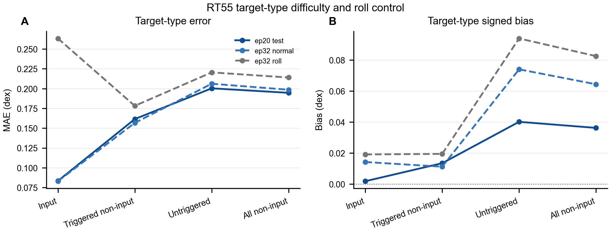
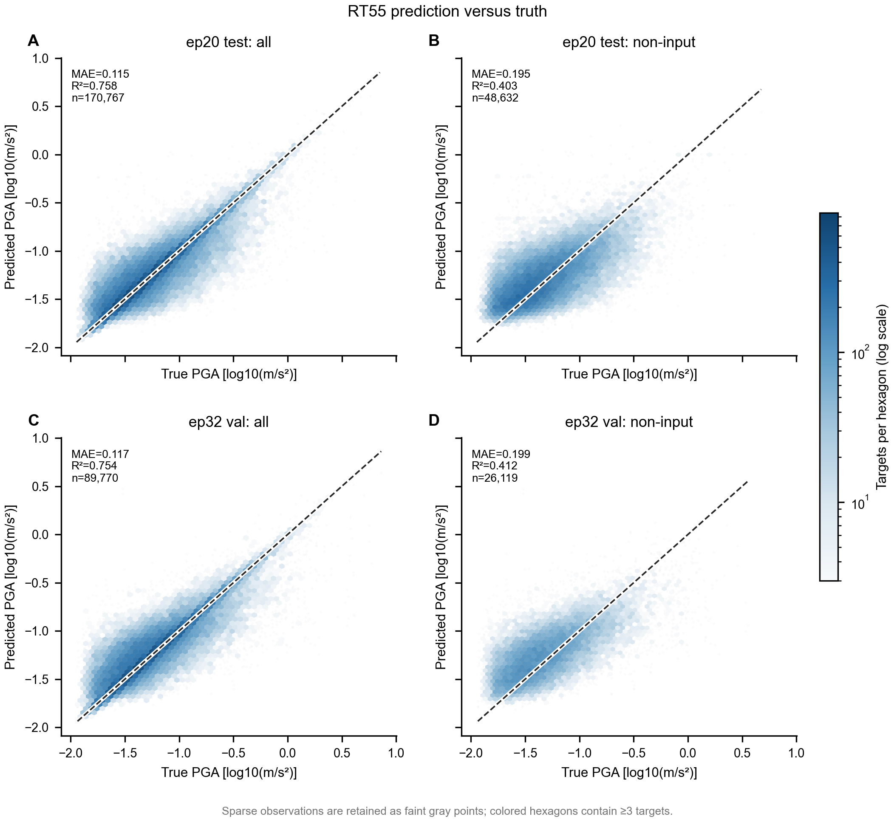
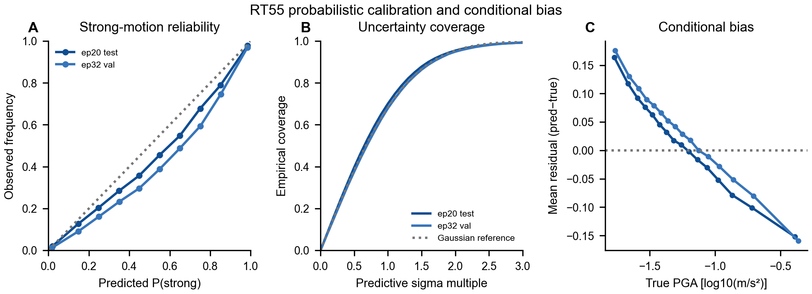
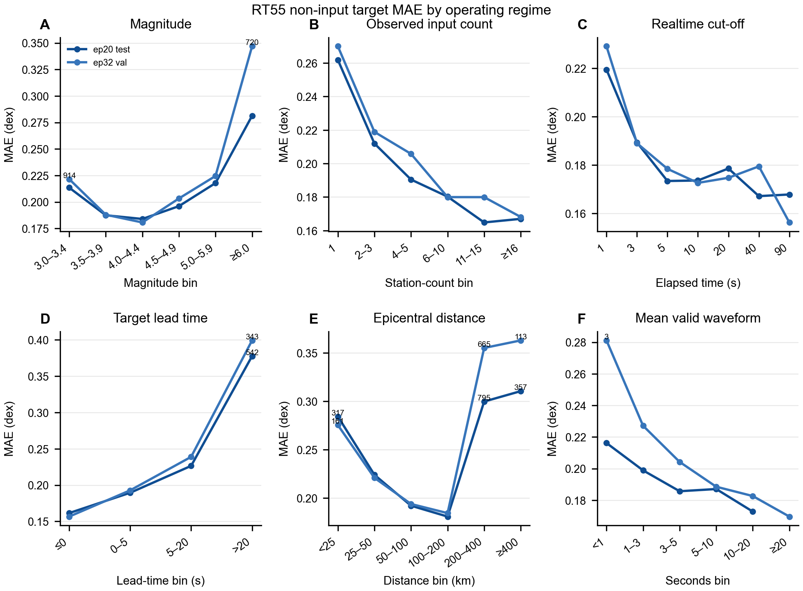
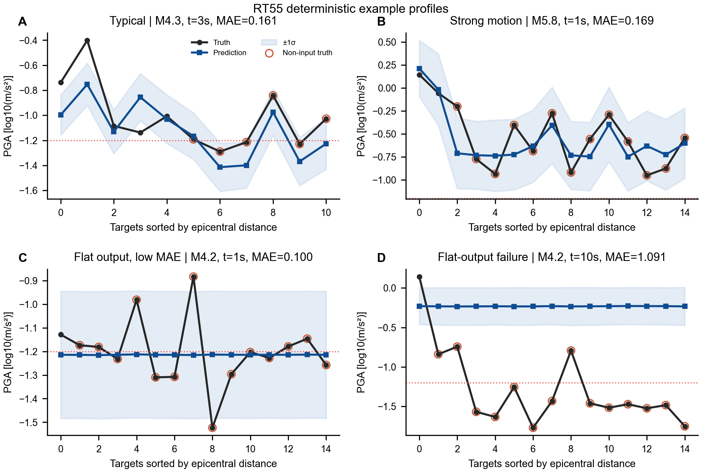
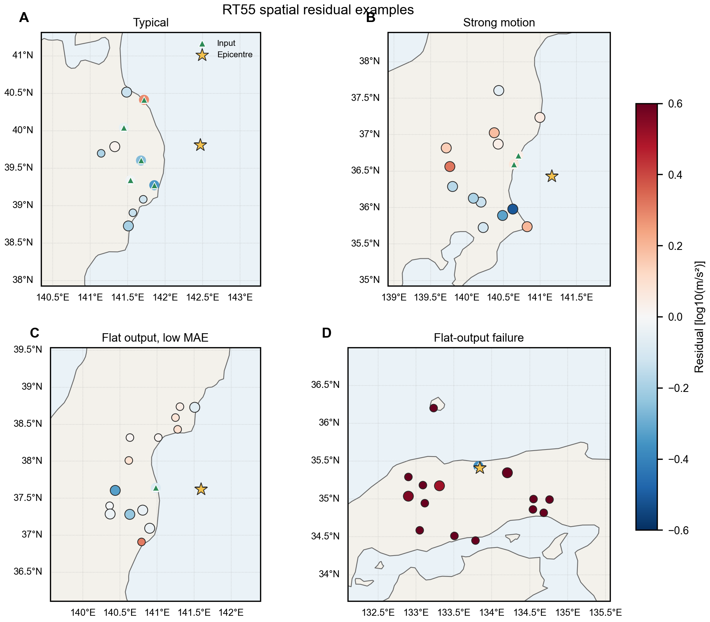

# RT55 当前结果全面报告

生成日期：2026-08-29
范围：RT55 独立报告；正文不使用其他模型作比较。PGA 坐标均为 log10(m/s²)。

## 1. 结论摘要

- 当前唯一完整的独立测试结果是 **epoch 20 held-out test**。其全目标 MAE=0.1151、RMSE=0.1777、R²=0.7578、NLL=-0.8720、Brier=0.0909；约等于典型绝对误差尺度 10^0.115≈1.30 倍。
- epoch 20 测试与 epoch 32 验证的全目标 MAE 分别为 0.1151 和 0.1166，总体量级一致；这支持常规验证口径下的稳定性，但不能替代缺失的 epoch 32 test。
- 排除所有输入台站后，epoch 20 测试 MAE 升至 0.1947，epoch 32 验证 MAE 升至 0.1986。因此全目标汇总确实被相对容易的输入台站目标显著拉低，**非输入台站应作为主要运行指标**。
- epoch 32 waveform-roll 控制的全目标 MAE=0.2490。它用于检验台站波形顺序扰动敏感性，不能解释成随机几何任务。
- 概率输出整体可用，但要同时看 NLL、Brier 和覆盖率。覆盖率理想参考约为 68.3%（1σ）和 95.4%（2σ）；偏离说明不确定度偏窄或偏宽。

## 2. 证据边界与命名

| 结果 | 数据 | checkpoint | 用途 |
| --- | --- | --- | --- |
| epoch 20 validation | validation | epoch 20 | 与同 checkpoint 的 test 对照 |
| epoch 20 held-out test | test | epoch 20 | 当前正式独立测试结论 |
| epoch 32 validation | validation | epoch 32 | 后期 checkpoint 的验证表现 |
| epoch 32 waveform-roll | validation | epoch 32 | 波形—台站顺序扰动控制 |

`formal_test_ep32_retry_20260824/` 是运行目录名，其中正式 metrics 元数据明确记录 checkpoint epoch=20；本报告始终标为 epoch 20 test。当前没有可用的 epoch 32 test 数值。

## 3. 训练、验证与测试数据分布

事件级概览：

| split | events | magnitude_min | magnitude_median | magnitude_max | depth_km_median | stations_per_event_median | year_min | year_max |
| --- | --- | --- | --- | --- | --- | --- | --- | --- |
| train | 9627 | 3.0000 | 3.9000 | 9.0000 | 26.0000 | 10.0000 | 2000.0000 | 2024.0000 |
| dev | 1383 | 3.0000 | 4.0000 | 8.0000 | 35.0000 | 11.0000 | 2000.0000 | 2024.0000 |
| test | 2769 | 3.0000 | 3.9000 | 7.4000 | 30.0000 | 10.0000 | 2000.0000 | 2024.0000 |

台站行级概览：

| split | station_rows | unique_stations | coordinate_cache_rows | coordinate_cache_coverage |
| --- | --- | --- | --- | --- |
| train | 146842 | 960 | 146404 | 0.9970 |
| dev | 22336 | 917 | 22271 | 0.9971 |
| test | 42368 | 952 | 42270 | 0.9977 |

按震级分桶的事件数：

| split | magnitude_bucket | events |
| --- | --- | --- |
| train | 3.0–3.4 | 1685 |
| train | 3.5–3.9 | 3195 |
| train | 4.0–4.4 | 2616 |
| train | 4.5–4.9 | 1232 |
| train | 5.0–5.9 | 732 |
| train | ≥6.0 | 167 |
| dev | 3.0–3.4 | 234 |
| dev | 3.5–3.9 | 457 |
| dev | 4.0–4.4 | 380 |
| dev | 4.5–4.9 | 178 |
| dev | 5.0–5.9 | 110 |
| dev | ≥6.0 | 24 |
| test | 3.0–3.4 | 550 |
| test | 3.5–3.9 | 889 |
| test | 4.0–4.4 | 746 |
| test | 4.5–4.9 | 341 |
| test | 5.0–5.9 | 201 |
| test | ≥6.0 | 42 |

解读：三个划分均覆盖 2000–2024 年，拆分单位是事件；不是按年份外推测试。震级分布以中小地震为主，M≥6 样本较少，故高震级分桶应结合事件数阅读。台站坐标缓存对各划分的台站行覆盖接近完整，地图主要用于覆盖审计，不用于声称均匀空间采样。

训练元数据不包含逐台站训练目标 PGA，因此本报告不虚构训练 PGA 分布。下图仅对有完整预测导出的 validation/test 目标真值作比较。

## 4. 训练过程

曲线是优化目标而非最终 PGA MAE。最佳 checkpoint 必须以保存元数据和独立评估共同确认，不能仅凭某一个 epoch 的训练 loss 下结论。

## 5. 总体指标与指标解读

| run | group | events | targets | mae | rmse | r2 | correlation | slope | bias | nll | brier | coverage_1sigma | coverage_2sigma | event_balanced_mae |
| --- | --- | --- | --- | --- | --- | --- | --- | --- | --- | --- | --- | --- | --- | --- |
| ep20 validation | all targets | 1383 | 89770 | 0.1162 | 0.1812 | 0.7524 | 0.8678 | 0.7634 | 0.0093 | -0.8667 | 0.0911 | 0.7017 | 0.9537 | 0.1129 |
| ep20 validation | non-input only | 1290 | 26119 | 0.1949 | 0.2568 | 0.4174 | 0.6621 | 0.5115 | 0.0316 | -0.0054 | 0.1578 | 0.6619 | 0.9309 | 0.2005 |
| ep20 held-out test | all targets | 2769 | 170767 | 0.1151 | 0.1777 | 0.7578 | 0.8714 | 0.7783 | 0.0116 | -0.8720 | 0.0909 | 0.7004 | 0.9544 | 0.1122 |
| ep20 held-out test | non-input only | 2547 | 48632 | 0.1947 | 0.2527 | 0.4029 | 0.6574 | 0.5181 | 0.0363 | -0.0073 | 0.1588 | 0.6590 | 0.9350 | 0.2022 |
| ep32 validation | all targets | 1383 | 89770 | 0.1166 | 0.1806 | 0.7541 | 0.8721 | 0.7720 | 0.0288 | -0.8867 | 0.0934 | 0.6787 | 0.9493 | 0.1141 |
| ep32 validation | non-input only | 1290 | 26119 | 0.1986 | 0.2581 | 0.4117 | 0.6759 | 0.5188 | 0.0644 | 0.0023 | 0.1643 | 0.6442 | 0.9325 | 0.2087 |

- MAE/RMSE 越低越好；RMSE 对少数大误差更敏感。
- R² 和相关系数越高越好，但相关高不等于校准好；回归斜率低于 1 表示振幅动态范围被压缩。
- bias=预测−真值；正值为整体高估，负值为整体低估。
- NLL 越低越好，同时评价均值与预测不确定度；不能跨不同坐标定义比较。
- Brier 越低越好，评价超过强震动阈值 −1.2 的概率预测。
- event-balanced MAE 先在每个事件内平均、再对事件平均，避免台站/时刻多的事件完全主导结果。

## 6. 非输入台站主分析

| run | group | events | targets | mae | rmse | bias | abs_error_p90 | abs_error_gt_0p3 |
| --- | --- | --- | --- | --- | --- | --- | --- | --- |
| ep20 held-out test | all non-input | 2547 | 48632 | 0.1947 | 0.2527 | 0.0363 | 0.4092 | 0.2110 |
| ep20 held-out test | input | 2769 | 122135 | 0.0834 | 0.1368 | 0.0018 | 0.2269 | 0.0520 |
| ep20 held-out test | triggered non-input | 457 | 7109 | 0.1615 | 0.2119 | 0.0135 | 0.3379 | 0.1372 |
| ep20 held-out test | untriggered | 2547 | 41523 | 0.2003 | 0.2591 | 0.0402 | 0.4190 | 0.2236 |
| ep32 validation | all non-input | 1290 | 26119 | 0.1986 | 0.2581 | 0.0644 | 0.4126 | 0.2190 |
| ep32 validation | input | 1383 | 63651 | 0.0830 | 0.1366 | 0.0142 | 0.2312 | 0.0552 |
| ep32 validation | triggered non-input | 257 | 4003 | 0.1567 | 0.2044 | 0.0112 | 0.3309 | 0.1297 |
| ep32 validation | untriggered | 1290 | 22116 | 0.2061 | 0.2666 | 0.0740 | 0.4261 | 0.2352 |

输入台站目标、已经触发但未输入的台站、尚未触发台站存在明确难度梯度。实际预警应用更应关注后两类，尤其是 untriggered 和正 lead-time 目标。报告同时导出每类的 P90/P95 绝对误差与大于 0.3/0.5 dex 的尾部比例。

## 7. 预测—真值、残差和概率校准

散点图使用 hexbin，避免海量重叠点造成视觉误判。条件残差曲线揭示强弱震动端的系统性偏差；概率可靠性图比较预测强震动概率和真实发生率；σ 覆盖曲线评估预测区间是否过窄或过宽。

散点视觉上比 MAE 更“散”并不矛盾：MAE 是所有点到对角线的平均绝对垂距，而图覆盖约 3 dex 的 PGA 动态范围并用对数颜色保留低密度离群点。epoch 20 test 的高密度主体仍贴近对角线，但斜率 0.778 表明明显的回归到均值/动态范围压缩。排除输入台站后 MAE 0.195、R² 0.403，散布确实显著增大，说明全目标 MAE 被容易的输入目标拉低。

## 8. 按震级、台站数、时刻、lead time、距离和波形长度分桶

所有折线旁的 CSV 均包含 targets 和 events。台站数曲线是**观测分层**，不是固定同一事件、只改变输入台站数的严格干预实验；因而不能直接解释为增加台站的因果收益。

关键分桶表位于 `tables/rt55_stratified_*.csv`。M≥6、长正 lead-time 和远距离桶尤其需要结合样本量；少量样本的波动不能当成模型结构性规律。

## 9. 波形—台站顺序扰动控制

正常验证与 waveform-roll 使用相同 epoch 32 checkpoint 和 validation 集。若 roll 明显恶化，说明波形与台站几何配对信息确实被模型使用；它不是“随机位置输入预测随机位置目标”的替代实验。

## 10. 具体抽样示例

案例由固定规则自动选择，不是手工挑图：

| case | event_id | sample_index | magnitude | current_time_s | station_count | targets | noninput_targets | strong_targets | true_range | pred_range | mae | bias | selection_rule |
| --- | --- | --- | --- | --- | --- | --- | --- | --- | --- | --- | --- | --- | --- |
| typical | 20041231173000 | 2752 | 4.3000 | 3.0000 | 5 | 11 | 6 | 8 | 0.8877 | 0.6614 | 0.1608 | -0.1048 | closest to median sample MAE |
| strong_motion | 20031115034400 | 1673 | 5.8000 | 1.0000 | 2 | 15 | 13 | 15 | 1.0950 | 0.9601 | 0.1692 | -0.0285 | median-MAE high-magnitude sample with >=2 strong targets |
| flat_low_mae | 20111127100700 | 7651 | 4.2000 | 1.0000 | 1 | 15 | 14 | 7 | 0.6399 | 0.0031 | 0.0996 | -0.0122 | flat spatial output selected by low aggregate MAE; retained as a cautionary example |
| flat_failure | 20161021145000 | 12526 | 4.2000 | 10.0000 | 1 | 15 | 14 | 4 | 1.9124 | 0.0057 | 1.0909 | 1.0413 | largest sample MAE among samples with >=3 non-input targets; flat-output failure |

空心强调的目标为非输入台站，地图三角形为实际输入台站，星号为震中。残差为预测−真值。底图使用 Natural Earth 50 m 海岸线，仅提供地理上下文。案例用于解释总体统计，不替代总体统计。

C/D 不是两个普通的随机坏例，而是同一个结构性模式：两者均只有一个有效输入台站，15 个目标的预测范围分别只有约 0.003 和 0.006 dex。单 key cross-attention 的注意力权重必然为 1，目标间差异只能依赖较弱的坐标/query 残差路径，因而容易退化为近常数输出。C 的 MAE 偶然较低，是因为真值大多集中在模型输出附近；它不能称为空间预测成功。

近常数输出审计（至少 5 个有效目标；预测范围≤0.03 dex；“真值多样”定义为真值范围≥0.30 dex）：

| minimum_valid_targets | flat_prediction_range_threshold_dex | diverse_truth_range_threshold_dex | eligible_realtime_samples | eligible_targets | flat_output_samples | flat_output_sample_fraction | flat_diverse_samples | flat_diverse_sample_fraction | flat_diverse_target_fraction | flat_diverse_mae_ge_0p3_samples | flat_diverse_mae_ge_0p3_fraction | flat_diverse_mae_ge_0p5_samples | flat_diverse_mae_ge_0p5_fraction | one_station_eligible_samples | one_station_flat_samples | one_station_flat_fraction |
| --- | --- | --- | --- | --- | --- | --- | --- | --- | --- | --- | --- | --- | --- | --- | --- | --- |
| 5.0000 | 0.0300 | 0.3000 | 13467.0000 | 156171.0000 | 519.0000 | 0.0385 | 503.0000 | 0.0374 | 0.0321 | 154.0000 | 0.0114 | 15.0000 | 0.0011 | 518.0000 | 518.0000 | 1.0000 |

该现象集中在单输入台站样本：所有 518 个满足目标数条件的单台站样本都落入近常数输出；但真正达到 MAE≥0.5 的灾难性样本仅 15 个，占合格 realtime 样本约 0.11%。因此它不是总体指标的主体，却是明确的早期预警/稀疏输入失效模式。

## 11. 局限与下一步

1. 只有 seed 42；事件 bootstrap 只反映事件抽样不确定性，不代表随机种子方差。
2. 当前没有 epoch 32 test，不能把 epoch 32 validation 重新命名为 test。
3. 训练 split CSV 没有逐目标 PGA，完整 train/dev/test PGA 分布需额外离线导出。
4. 严格台站数 sweep 需要锁定事件、时刻、目标集合和台站排序后重新推理；当前文件只能做观测分层。
5. 当前 NPZ 不含 attention 权重，不能生成真实 attention map。若需该图，必须在推理阶段显式导出权重。
6. 单次结果不能覆盖跨地区、跨网络或跨年份分布偏移。
7. 单输入台站条件下的近常数退化需要单独修复；平均 MAE 会低估其空间辨识失败。

## 12. 可复现文件

- `tables/rt55_aggregate_metrics.csv`：全指标和目标分组。
- `tables/rt55_stratified_*.csv`：所有分桶结果。
- `tables/rt55_flat_output_audit.csv`：单台站近常数输出的发生比例与严重度。
- `../tables/checkpoint_provenance.csv`：checkpoint 与评估文件来源。
- 每张图同名 `.csv`：实际绘图数据；`.svg` 保留可编辑文本，`.pdf` 为矢量输出，`.png` 为 300 dpi 预览。
- `../qa/`：数值一致性和图形产物审计。
