# RT56 随机几何微调当前结果全面报告

生成日期：2026-08-29
范围：RT56 mixed-random fine-tuning 的 validation 结果；允许与 RT55 同 checkpoint 起点和同协议 normal validation 对照。当前没有 RT56 held-out test。

## 1. 结论摘要

- 严格配对的随机几何 validation 中，MAE 从 0.2831 降至 0.2572（-9.1%），RMSE 从 0.3820 降至 0.3313（-13.3%），R² 从 0.0885 升至 0.3144。
- 不确定性明显修复：NLL 从 1.4739 降至 0.2553，Brier 从 0.2498 降至 0.1999；1σ/2σ 覆盖从 0.442/0.692 变为 0.655/0.941，更接近约 0.683/0.954 的参考覆盖率。
- 收益并不均匀：新增因果台站数较多时改善更明显；强震动目标显著改善，但弱震动段出现更强的正偏差；较长正 lead-time 目标仍是主要难点。
- normal validation 出现可测遗忘：全目标 MAE 0.1166→0.1338（+14.7%）；非输入目标 MAE 0.1986→0.2220（+11.8%）。这说明 mixed-random 的收益需要与原任务保持性共同优化。
- 随机几何导出的所有目标都属于 triggered non-input 或 untriggered；坐标审计在 1e-6 度容差下发现 0 个目标与选中输入台站重合。

## 2. 实验设计与可比性

严格 adaptation 比较是：

`RT55 epoch 32 zero-shot random geometry` → `RT56 epoch 6 fine-tuned random geometry`

两者使用相同 validation 样本、时刻和目标，目标级一一配对。normal 保持性比较是：

`RT55 epoch 32 normal validation` → `RT56 epoch 6 normal validation`

random 和 normal 的目标构造不同，二者的绝对指标不作同任务排名。

## 3. 底层训练、验证与保留测试数据分布

RT56 配置记录的 K-NET 过滤后事件划分与当前 RT55 数据清单一致：train 9,627 个事件、dev 1,383 个事件、test 2,769 个事件。test 仍是保留划分，但当前报告没有可用的 RT56 test 推理结果。

| split | events | magnitude_min | magnitude_median | magnitude_max | depth_km_median | stations_per_event_median | year_min | year_max |
| --- | --- | --- | --- | --- | --- | --- | --- | --- |
| train | 9627 | 3.0000 | 3.9000 | 9.0000 | 26.0000 | 10.0000 | 2000.0000 | 2024.0000 |
| dev | 1383 | 3.0000 | 4.0000 | 8.0000 | 35.0000 | 11.0000 | 2000.0000 | 2024.0000 |
| test | 2769 | 3.0000 | 3.9000 | 7.4000 | 30.0000 | 10.0000 | 2000.0000 | 2024.0000 |

| split | station_rows | unique_stations | coordinate_cache_rows | coordinate_cache_coverage |
| --- | --- | --- | --- | --- |
| train | 146842 | 960 | 146404 | 0.9970 |
| dev | 22336 | 917 | 22271 | 0.9971 |
| test | 42368 | 952 | 42270 | 0.9977 |

按震级分桶事件数：

| split | magnitude_bucket | events |
| --- | --- | --- |
| train | 3.0–3.4 | 1685 |
| train | 3.5–3.9 | 3195 |
| train | 4.0–4.4 | 2616 |
| train | 4.5–4.9 | 1232 |
| train | 5.0–5.9 | 732 |
| train | ≥6.0 | 167 |
| dev | 3.0–3.4 | 234 |
| dev | 3.5–3.9 | 457 |
| dev | 4.0–4.4 | 380 |
| dev | 4.5–4.9 | 178 |
| dev | 5.0–5.9 | 110 |
| dev | ≥6.0 | 24 |
| test | 3.0–3.4 | 550 |
| test | 3.5–3.9 | 889 |
| test | 4.0–4.4 | 746 |
| test | 4.5–4.9 | 341 |
| test | 5.0–5.9 | 201 |
| test | ≥6.0 | 42 |

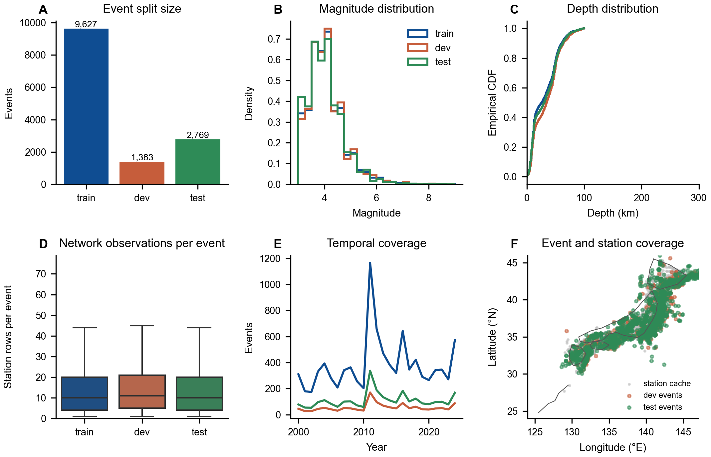

三个划分均覆盖 2000–2024 年，M≥6 事件明显较少。训练清单没有逐目标 PGA 真值导出，因此不将 normalization 统计伪装成训练 PGA 直方图。

## 4. 随机几何输入、时刻和目标分布

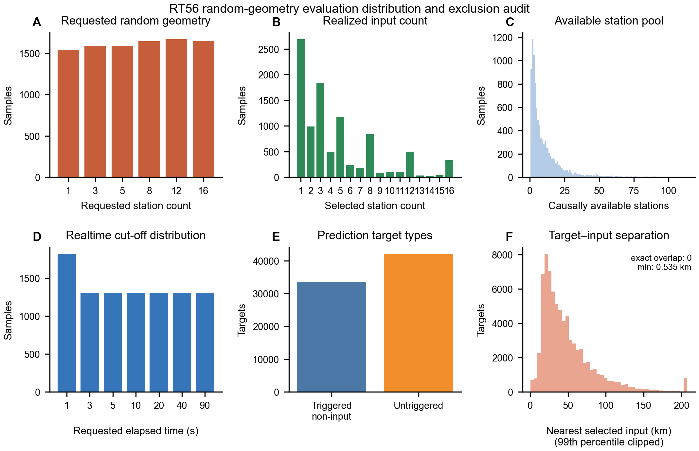

requested K、selected K 和 causally available K 被分别展示。selected K 小于 requested K 时说明截止时刻可用台站不足，不应把它当成数据错误。所有随机目标都排除输入台站，因此这是“随机位置波形预测其他随机位置 PGA”的直接验证。

坐标排除审计：

| run | targets | overlap_targets_tol_1e-6 | overlap_fraction_tol_1e-6 | minimum_coord_delta_deg | p01_coord_delta_deg | minimum_geodesic_distance_km | p01_geodesic_distance_km | audit_basis |
| --- | --- | --- | --- | --- | --- | --- | --- | --- |
| RT55 ep32 zero-shot random | 75654 | 0 | 0.0000 | 0.0056 | 0.0583 | 0.5351 | 5.8553 | target and valid selected-input coordinates |
| RT56 ep6 fine-tuned random | 75654 | 0 | 0.0000 | 0.0056 | 0.0583 | 0.5351 | 5.8553 | target and valid selected-input coordinates |

审计使用有效目标坐标与有效选中输入台站坐标，而不是直接比较两个未确认共享命名空间的整数 index。最小距离大于零支持排除成立；index 数值碰巧相同不能据此判重。

## 5. 微调过程

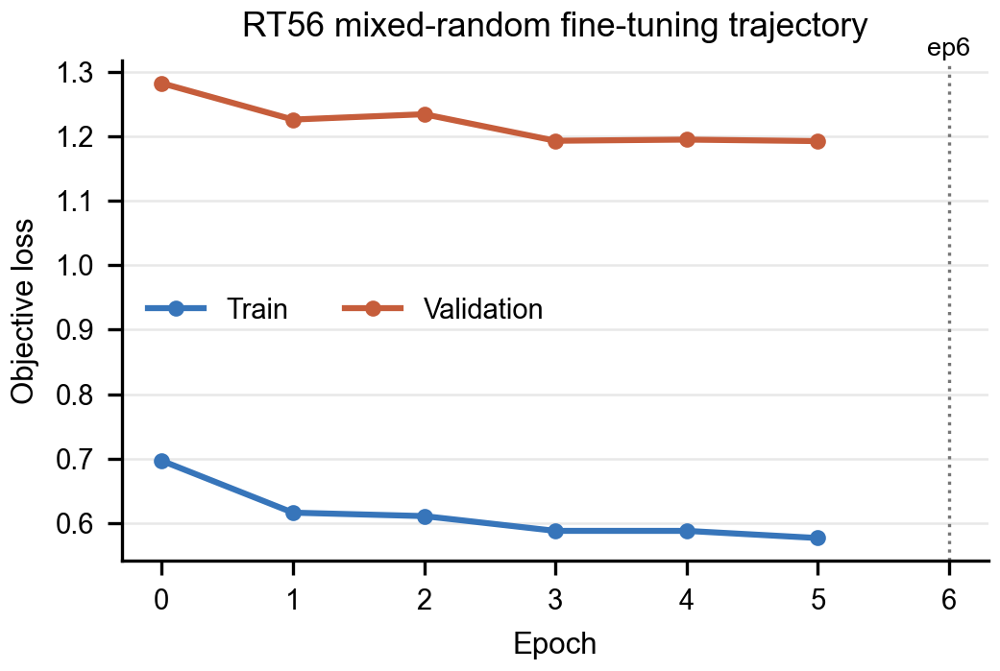

validation loss 是混合训练目标；最终判断仍以同协议 PGA validation 为准。当前最佳 checkpoint 元数据为 epoch 6。

## 6. 总体指标

| run | group | events | targets | mae | rmse | r2 | correlation | slope | bias | nll | brier | predictive_sigma_mean | coverage_1sigma | coverage_2sigma | event_balanced_mae |
| --- | --- | --- | --- | --- | --- | --- | --- | --- | --- | --- | --- | --- | --- | --- | --- |
| RT55 ep32 normal | all targets | 1383 | 89770 | 0.1166 | 0.1806 | 0.7541 | 0.8721 | 0.7720 | 0.0288 | -0.8867 | 0.0934 | 0.1384 | 0.6787 | 0.9493 | 0.1141 |
| RT55 ep32 normal | non-input only | 1290 | 26119 | 0.1986 | 0.2581 | 0.4117 | 0.6759 | 0.5188 | 0.0644 | 0.0023 | 0.1643 | 0.2275 | 0.6442 | 0.9325 | 0.2087 |
| RT55 ep32 zero-shot random | all targets | 1310 | 75654 | 0.2831 | 0.3820 | 0.0885 | 0.4405 | 0.2959 | -0.0913 | 1.4739 | 0.2498 | 0.1897 | 0.4423 | 0.6918 | 0.2831 |
| RT55 ep32 zero-shot random | non-input only | 1310 | 75654 | 0.2831 | 0.3820 | 0.0885 | 0.4405 | 0.2959 | -0.0913 | 1.4739 | 0.2498 | 0.1897 | 0.4423 | 0.6918 | 0.2831 |
| RT56 ep6 fine-tuned random | all targets | 1310 | 75654 | 0.2572 | 0.3313 | 0.3144 | 0.5710 | 0.3478 | 0.0404 | 0.2553 | 0.1999 | 0.3037 | 0.6549 | 0.9411 | 0.2607 |
| RT56 ep6 fine-tuned random | non-input only | 1310 | 75654 | 0.2572 | 0.3313 | 0.3144 | 0.5710 | 0.3478 | 0.0404 | 0.2553 | 0.1999 | 0.3037 | 0.6549 | 0.9411 | 0.2607 |
| RT56 ep6 normal | all targets | 1383 | 89770 | 0.1338 | 0.2000 | 0.6984 | 0.8512 | 0.7317 | 0.0587 | -0.8163 | 0.1028 | 0.1814 | 0.7547 | 0.9731 | 0.1410 |
| RT56 ep6 normal | non-input only | 1290 | 26119 | 0.2220 | 0.2838 | 0.2886 | 0.6570 | 0.5138 | 0.1200 | 0.0468 | 0.1776 | 0.2717 | 0.6718 | 0.9598 | 0.2297 |

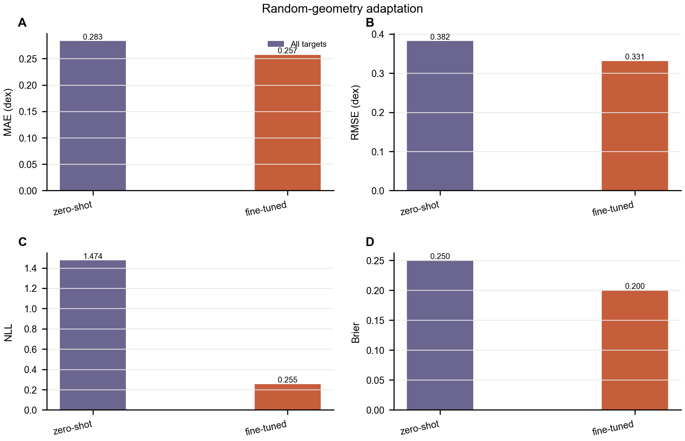

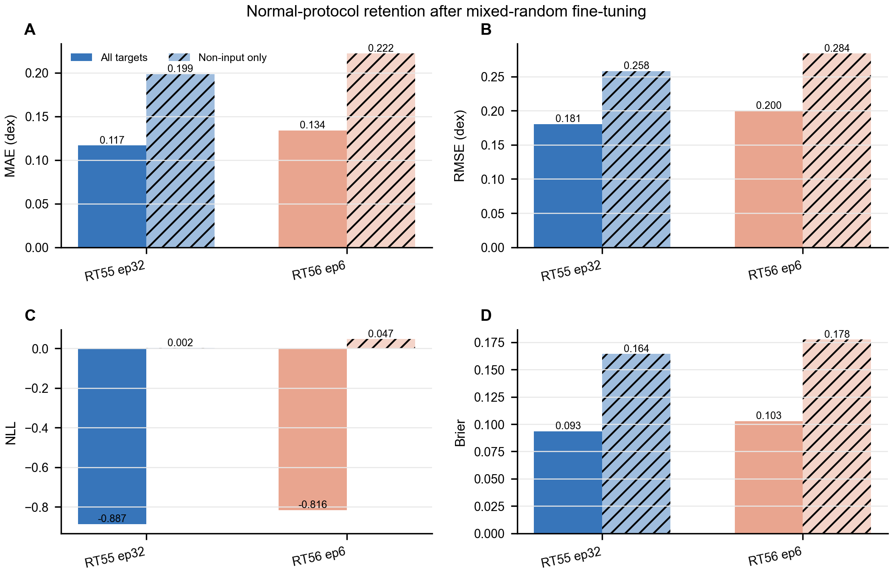

指标阅读规则与 RT55 报告相同。尤其注意：NLL 的大幅改善部分来自 σ 从过窄恢复到更合理范围，不能只看点预测 MAE；normal 任务 σ 同时变宽并产生过覆盖，需要与遗忘一起解读。

## 7. 严格配对改善与事件 bootstrap

| events | targets | event_balanced_before_mae | event_balanced_after_mae | event_balanced_delta_mae | bootstrap_ci95_low | bootstrap_ci95_high | bootstrap_replicates | bootstrap_seed |
| --- | --- | --- | --- | --- | --- | --- | --- | --- |
| 1310.0000 | 75654.0000 | 0.2831 | 0.2607 | -0.0223 | -0.0259 | -0.0190 | 1000.0000 | 42.0000 |

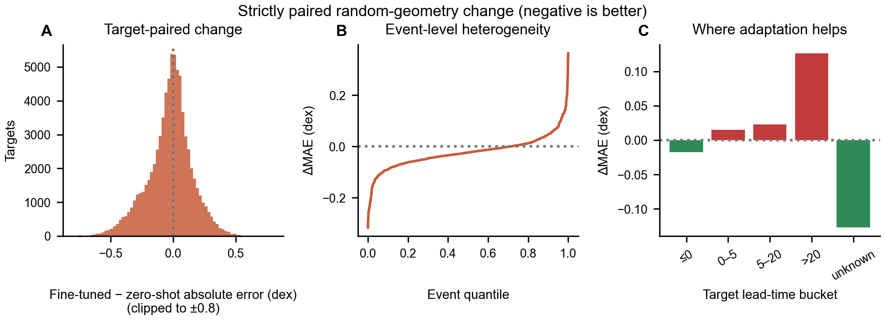

bootstrap 以事件为簇，对每个事件的平均 ΔMAE 重采样；负值表示 fine-tuning 后更好。它反映 validation 事件抽样不确定性，不包含不同随机种子训练方差。

## 8. 预测—真值、概率校准与系统偏差

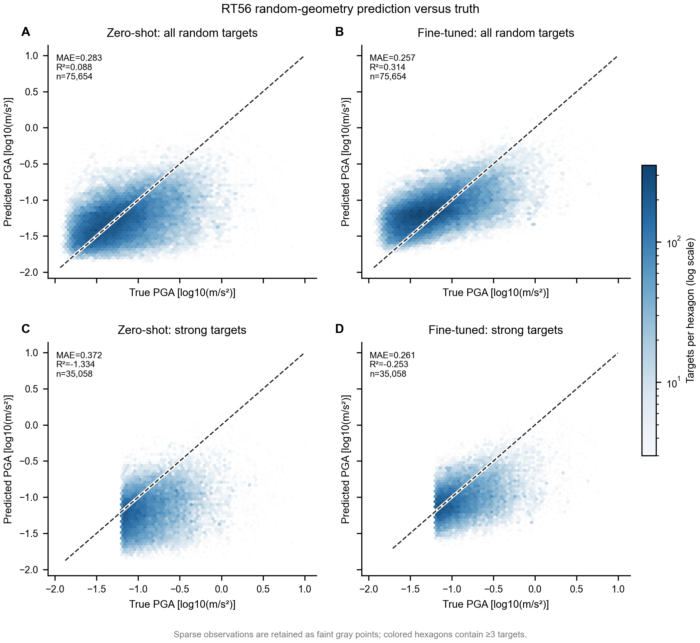

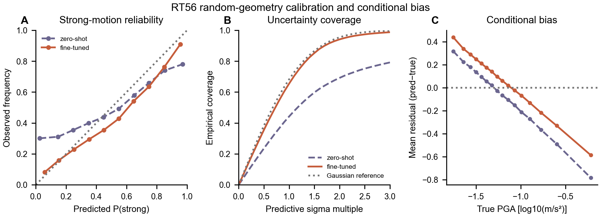

zero-shot 的动态范围压缩和强震动低估在 fine-tuning 后缓解，但没有完全消失。强震动概率可靠性、Brier、覆盖率和条件 bias 应联合阅读，避免把单个阈值指标误当成完整校准结论。

## 9. 按台站数、时刻、震级、目标类型、lead time 和强弱 PGA 分桶

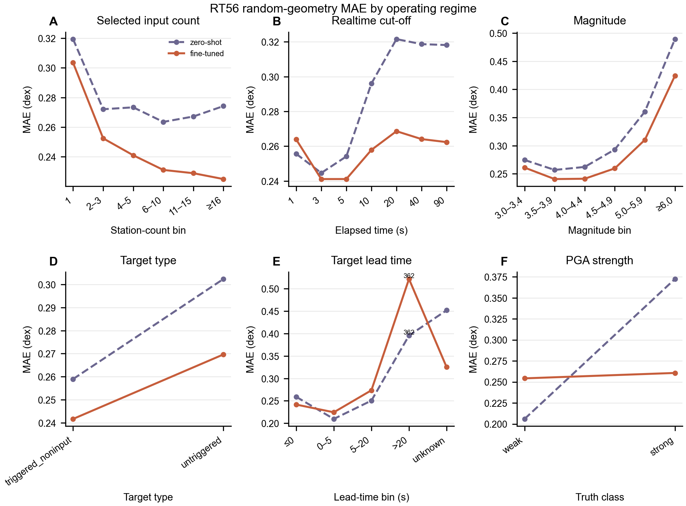

台站数分桶显示 fine-tuned 模型在较多选中台站时继续受益，这是支持随机几何微调有效的关键证据。不过它仍是 validation 上的观测分层；严格 station-count sweep 需要固定同一事件、时刻、目标和台站排序重新推理。

lead time 结果说明：模型对尚未来得及观测到目标台站信号的任务仍明显更难；unknown 必须单列，不能混入 ≤0 目标。强/弱 PGA 分桶则揭示 fine-tuning 将一部分零样本时的强震动低估，转化为弱震动段的正偏差。

## 10. normal 任务保持性与非输入目标

normal 对照必须同时报告 all targets 和 non-input only。全目标中的输入台站相对容易，会掩盖远端预测性能下降。当前结果表明微调不是“无代价适配”：随机几何能力提升的同时，normal MAE、RMSE、Brier 和预测 σ 均发生退化或变宽。

下一轮训练应考虑：提高 normal batch 权重、加入明确的保持性正则/蒸馏，或以 random MAE 与 normal non-input MAE 的 Pareto 前沿选 checkpoint，而不是只按混合 validation loss 选点。

## 11. 具体抽样示例

案例由固定规则自动选择：

| case | event_id | sample_index | magnitude | current_time_s | targets | strong_targets | mae_before | mae_after | delta_mae | selection_rule |
| --- | --- | --- | --- | --- | --- | --- | --- | --- | --- | --- |
| largest_gain | 20170910174400 | 6817 | 5.6000 | 90.0000 | 15 | 13 | 1.0544 | 0.3627 | -0.6917 | largest reduction in sample MAE among samples with >=5 targets |
| typical_gain | 20190907170100 | 7537 | 4.0000 | 40.0000 | 15 | 8 | 0.2690 | 0.2586 | -0.0103 | closest to median sample-level change; distinct from other cases |
| largest_degradation | 20110917060800 | 3978 | 6.1000 | 5.0000 | 8 | 6 | 0.1420 | 0.5097 | 0.3677 | largest increase in sample MAE among samples with >=5 targets |
| strong_recovery | 20070905001900 | 2213 | 3.7000 | 3.0000 | 9 | 2 | 1.0766 | 0.4144 | -0.6622 | largest distinct gain with >=2 strong targets |
| unknown_lead_gain | 20120830040500 | 4520 | 5.6000 | 40.0000 | 15 | 14 | 1.3322 | 0.7599 | -0.5722 | largest distinct gain among samples containing unknown lead-time targets |
| positive_lead_degradation | 20171006165900 | 7073 | 6.3000 | 10.0000 | 13 | 7 | 0.2612 | 0.5910 | 0.3298 | largest distinct degradation among samples containing positive lead-time targets |

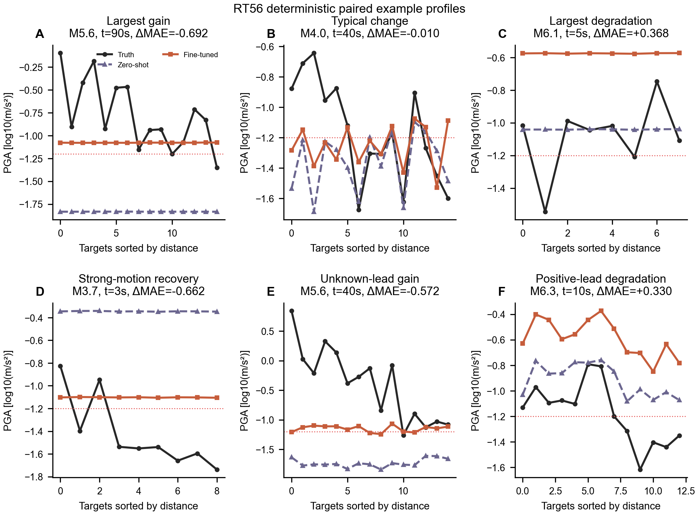

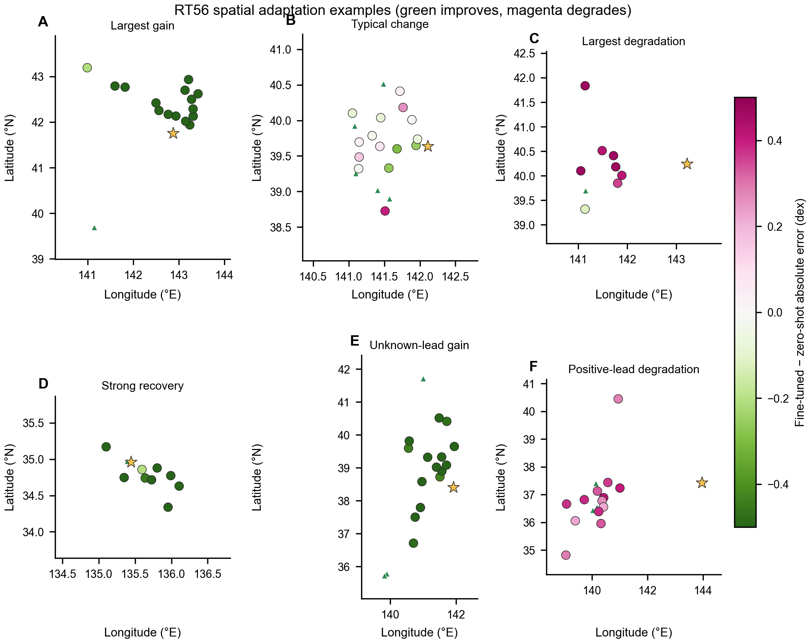

空间图颜色为 fine-tuned − zero-shot 的绝对误差：绿色为改善、洋红为退化。案例覆盖最大改善、中位变化、最大退化、强震动恢复、unknown-lead 改善和正 lead-time 退化。

## 12. 局限与必须补做的实验

1. 当前只有 validation，没有 RT56 held-out test。
2. 只有一个训练 seed；事件 bootstrap 不能替代多 seed。
3. 需要 controlled station-count sweep 才能严谨回答“多一个台站带来多少收益”。
4. 需要在 inference 中导出 attention 权重才能绘制真实 attention map；当前不制造替代图。
5. 应补 normal/random 多目标 checkpoint 选择，验证能否减少 normal forgetting。
6. 应增加按地区、网络、目标—输入最邻近距离和高震级事件的外部/压力测试。

## 13. 可复现文件

- `tables/rt56_aggregate_metrics.csv`、`tables/rt56_stratified_*.csv`。
- `tables/rt56_coordinate_exclusion_audit.csv`：目标排除输入台站审计。
- `tables/rt56_paired_event_bootstrap.csv` 和事件级明细。
- 每张图同名 CSV + SVG/PDF/PNG；SVG/PDF 文本可编辑，PNG 为 300 dpi。
- `../qa/`：正式 metrics 复算一致性与产物审计。
