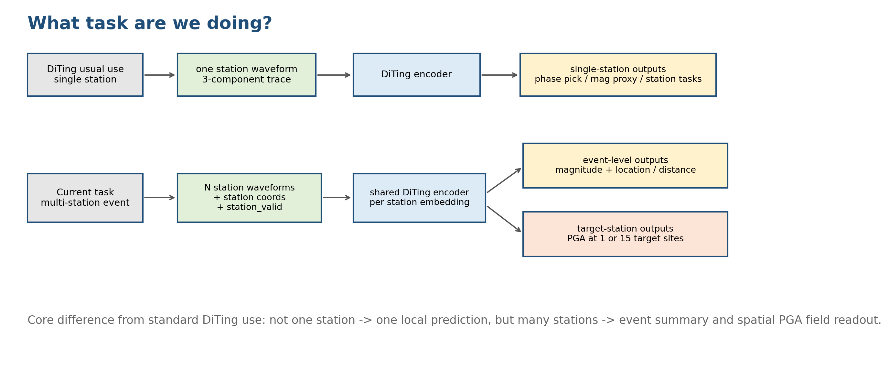

# 多台站波形驱动的任意目标位置 PGA 估计：最新进展与阶段判断

状态：详细页纲与旧版视觉系统已确认；2026-09-30 用户同意改用原生 PPT 排版继续制作，并要求增加旧版散点图对比。按已确认的 20 页主报告 + 6 页附录制作；标题、正文、表格、架构为可编辑对象，科研图从核验数据生成后原图等比例嵌入，不再使用整页图片生成。

定位：内部技术交流。沿用 `multistation_pga_exchange_20260726.pptx` 的浅灰白底、蓝/青/珊瑚强调色、技术卡片和细线框视觉语言，但更新全部关键数据、模型架构和结论。

规模：20 页主报告 + 6 页附录，建议汇报 25–30 分钟。

统一表达原则：

- RT61 是时间上最新、点预测指标略优的候选；RT59 仍是当前 development parent。
- RT57–RT61 只报告固定 Japan 2000–2024 validation、seed42；不写成 held-out test 结论。
- 与 2026-07-26 旧报告的数字同时给出“严格同口径提升”和“历史背景对照”，不把不同数据与协议混成排行榜。
- PGA 回归指标统一为 `log10(m/s²)`；跨文献换算或不同任务必须在图中直接标注。

## 主报告

### Slide 1：封面

- 标题：多台站波形驱动的任意目标位置 PGA 估计
- 日期：2026-09-30
- 版式角色：极简封面；只保留标题与日期，不使用副标题、示意图、图标或其他视觉符号。

### Slide 2：结论先行——精度持续改善，但空间场目标尚未完成

- 最新 RT61 random validation：MAE `0.2373`、RMSE `0.3101`、R² `0.3994`、slope `0.4113`。
- normal all MAE `0.1250`；normal non-input MAE `0.1992`。
- 相对固定 RT57，random MAE 下降 `3.36%`，normal non-input MAE 下降 `5.29%`。
- RT61 的单站 pairwise-delta MAE 仅改善约 `0.38%`，未达到预设 `2%`；因此保留 RT59 作为开发主线。
- 版式角色：执行摘要；四张指标卡 + 一条“最新候选 / 当前主线”判定带。

### Slide 3：任务升级——从近站推断扩展到随机观测、随机目标

- 输入：截至指定时刻、随机位置和随机数量台站的三分量波形、坐标及有效 mask。
- 查询：随机目标位置；目标可与输入台站同址，也可以是完全未观测位置。
- 输出：目标位置 PGA 的概率分布及预测均值。
- normal geometry 与 random geometry 回答不同难度的问题；远程 non-input 目标是核心应用对象。
- 版式角色：任务定义与难度升级对照。
- Required image：
  - 旧版多台站任务示意，仅作内容与布局参考；新版需增加 random input / random query 和 local / remote route。

    

### Slide 4：相关工作与本项目定位

- GMPE：以震源、距离和场地参数建模，解释性强，但依赖震源参数并将复杂波形信息压入残差。
- TEAM：任意台站集合到任意目标位置的概率 PGA，是最接近本任务的实时预警范式。
- QuakeFormer：通过 mask 统一 forecasting、interpolation 与 EEW，提供 seen/unseen station 参照。
- 本项目：冻结 DiTing 波形骨干，重点研究 random geometry 下的站点辨识、local/remote 路由和空间场差异恢复。
- 版式角色：三列方法谱系 + 本项目位置。
- Required images：
  - TEAM workflow；严格输入资产，保留原论文图示含义。

    

  - QuakeFormer framework；严格输入资产，保留任务 mask 与空间表示结构。

    

### Slide 5：数据集、划分与正式评估协议

- Japan 2000–2024，共 25 个年度训练 shards。
- 过滤后 event-level split：train `9,627`、validation `1,383`、test `2,769` events。
- formal normal validation：9,681 realtime rows、89,770 targets；random validation：9,681 rows、75,654 targets。
- random 覆盖 1/3/5/10/20/40/90 s 和随机实际输入台站数；normal 作为保留能力与兼容性检查。
- RT57–RT61 未运行 held-out test；所有结论均标注 validation、seed42。
- 版式角色：数据规模卡片 + 协议流程图 + split 边界。

### Slide 6：从旧版报告到 RT61 的技术演进

- 2026-07：固定/常规几何下的 full-data 与 512-event 机制诊断。
- RT55/56：建立 normal 与 random-geometry 基线，并完成 ep20 test 锚点。
- RT57：station-distinctive temporal adapter，恢复波形与台站差异。
- RT58：waveform-anchor transfer field；总体未带来有效替代。
- RT59：local / transport 双路由与 random/normal 分组联合目标，形成当前主线。
- RT60/61：分别检验 final contrast readout 与 wave-geometry residual conditioning；均为部分机制成功但未晋级。
- 版式角色：横向时间线；绿色表示保留主线，灰蓝表示基线，珊瑚表示未晋级实验。

### Slide 7：当前系统总体架构

- DiTing encoder 从各台站三分量波形提取 temporal tokens。
- station-distinctive adapter 聚合时序、幅度和有效时长，得到 absolute station state 与 event-centered residual。
- TEAM-style station set / event representation 建模多台站上下文。
- target-wise query decoder 将目标坐标与 station memory 对齐，输出 frozen base MDN。
- RT59 local / transport correction 与 RT61 wave-geometry adapter 只平移 mixture means；logits 与 sigma 保持冻结。
- 版式角色：宽屏五阶段系统架构；明确冻结模块、可训练模块和输出。
- Required sources：
  - `docs/rt57_gtnp_v2_station_distinctive.md`
  - `docs/rt59_dual_objective_transport_v3.md`
  - `docs/rt61_wave_geometry_residual.md`

### Slide 8：RT59 双路由与 RT61 单一机制实验

- 与有效输入站唯一同址的 query 走 local correction；无匹配或歧义匹配走 transport。
- forward 路由只使用坐标和 mask，不使用标签、target type 或 random/normal 协议位。
- RT61 在 RT59 pair representation 上增加 rank-16 wave × geometry residual adapter；只允许 99,621 个标量更新。
- immutable RT59 teacher 与 RT61 student 共享同次 forward，保证配对比较。
- 版式角色：上半部分 local/transport 路由，下半部分 RT61 residual adapter 放大图。

### Slide 9：训练目标与验收逻辑

- RT59 对 random non-input、normal input、normal other 使用固定 `0.50/0.25/0.25` 分组权重。
- 主损失包含 MDN NLL、SmoothL1 和 MSE；remote 分支再约束相对传递和场内差异。
- RT60/61 使用 point fidelity、parent-regret 与 field-contrast 的联合机制门槛。
- 验收不是只看总体 MAE：必须同时检查 slope、P95−P05 range、单站 pairwise error、normal retention 和 calibration。
- 版式角色：目标函数分解 + “pointwise / spatial / calibration / retention”四类门槛。

### Slide 10：最新总体指标——RT61 点预测最好，RT59 仍是主线

- 统一列出 RT57 historical、RT59 reference 和 RT61 candidate 的 random / normal all / normal non-input 指标。
- random：RT61 MAE `0.2373`、RMSE `0.3101`、R² `0.3994`、slope `0.4113`、NLL `0.1962`、Brier `0.1834`。
- normal all：MAE `0.1250`、R² `0.7388`；normal non-input：MAE `0.1992`、R² `0.4223`。
- RT61 legacy required gates 仍为 `18/25`，useful joint progress 为 false。
- 版式角色：指标表 + 判定卡；视觉上突出“最佳观测值”和“是否晋级”是两个维度。
- Required data：
  - `reports/rt61_wave_geometry_validation_20260928/group_metrics.csv`
  - `reports/rt61_wave_geometry_validation_20260928/legacy_gates.csv`
  - `reports/rt61_wave_geometry_validation_20260928/decision.json`

### Slide 11：严格同口径提升——RT57 → RT59 → RT61

- random MAE：`0.2456 → 0.2378 → 0.2373`；RT57→RT61 下降 `3.36%`。
- random R²：`0.3675 → 0.3950 → 0.3994`；绝对增加 `0.0319`。
- normal all MAE：`0.1310 → 0.1250 → 0.1250`；下降 `4.60%`。
- normal non-input MAE：`0.2104 → 0.1993 → 0.1992`；下降 `5.29%`。
- 1 s random MAE：`0.2551 → 0.2434 → 0.2429`；下降 `4.79%`。
- 版式角色：配对 slopegraph / dumbbell chart；CI 可用处显示 event-cluster 95% 区间。

### Slide 12：相比 2026-07-26 报告，提升不仅是数字

- 旧报告系统锚点：699/101/201 events，validation MAE `0.2966`、R² `0.5221`、slope `0.5931`。
- 当前系统使用 Japan 2000–2024 更大 event split，并将任务扩展到 random input / random query。
- 当前 random MAE `0.2373`、normal non-input MAE `0.1992`；数值显著低于旧锚点，但协议不同，只作历史背景。
- 方法层面从 generic cross-attention 发展到 station-distinctive state、observable local/remote routing 和 wave-geometry conditioning。
- 版式角色：“旧版 → 当前”双栏；分别标注可严格比较与不可直接比较的内容。
- 用户新增要求：使用旧版 Slide 11 所引用的真实评估 NPZ，核验 1,393 个有效 validation targets 与原指标一致后重绘散点图。与 RT61 normal all / normal non-input 并列展示，三图采用共同轴域、等比例坐标与一致标注；不计算跨协议提升百分比。
- Required style/content reference：
  - `../../../../team_pytorch/reports/technical_exchange/multistation_pga_exchange_20260726/multistation_pga_exchange_20260726.pptx`

### Slide 13：真实 PGA 与预测 PGA——四种正式目标总体分布

- 2×2 面板：random、normal all、normal input、normal non-input。
- 横轴 truth、纵轴 prediction，统一 `log10(m/s²)` 坐标、相同比例、1:1 线。
- 使用低透明度散点并叠加轻量密度等高线，面板内标注 n、MAE、R²、slope。
- 重点指出 random 与 normal non-input 的动态范围压缩，以及 normal input 的明显更高精度。
- 版式角色：主证据散点图。
- Required data：
  - `chaosuan_res/weights_japan_full_2000_2024_rt61_wave_geometry_residual_seed42.zip` 中两份 epoch-8 formal NPZ。

### Slide 14：散点分层——台站数与输入时间如何改变预测

- random 按实际有效台站数分为 `K=1`、`K=2–5`、`K≥6`；统一轴域和透明度。
- 按输入时刻归并为 early `1–5 s`、mid `10–20 s`、late `40–90 s`。
- 图中同时显示各组 MAE / R²；避免用点密度差异误判性能。
- 预期结论：更多台站总体有效，但不是单调；random 任务中时间收益弱于旧版 normal 诊断。
- 版式角色：六个小型散点面板 + 简洁指标条。
- Required data：
  - RT61 random NPZ。
  - `reports/rt61_wave_geometry_validation_20260928/strata_metrics.csv`。

### Slide 15：误差分层——强震、少站和高震级仍是主要难点

- target type：triggered non-input 优于 untriggered。
- magnitude：M≥5 后误差明显增加；M≥7 样本很少但退化显著。
- truth PGA：高 PGA 区间继续出现系统性低估和动态范围压缩。
- actual station count：总体随台站增加改善，但受事件难度与几何覆盖影响，不宜宣称单调关系。
- 版式角色：四个共享视觉语法的分层 MAE / bias 图。
- Required data：
  - `reports/rt61_wave_geometry_validation_20260928/strata_metrics.csv`。

### Slide 16：空间场结果——局部改善尚不足以完成目标

- random P95−P05 range ratio：RT57 `0.5102`，RT59 `0.4753`，RT61 `0.4855`；仍低于门槛 `0.55`。
- actual-one-station range ratio：`0.2073 → 0.1786 → 0.1905`；仍低于 `0.25`。
- one-station pairwise-delta MAE：RT59 `0.3362` → RT61 `0.3349`，仅改善约 `0.38%`，仍高于 `0.33`。
- RT61 能恢复少量空间反差，但没有把点预测收益转化为足够的场内差异恢复。
- 版式角色：range ratio 与 pairwise 指标的门槛图 + 典型 field 小图。
- Required data：
  - `reports/rt61_wave_geometry_validation_20260928/field_metrics.csv`
  - `reports/rt61_wave_geometry_validation_20260928/fixed_examples.png`

### Slide 17：概率输出与校准——分数改善不等于完全校准

- RT61 random NLL `0.1962`、Brier `0.1834`，相对 RT57 均改善。
- normal all NLL `-0.8482`、Brier `0.0953`。
- random 与 normal 的 1σ coverage retention 仍未通过门槛；2σ 相对稳定。
- sigma 未随 RT59–RT61 mean correction 联合更新，是当前校准能力的结构限制之一。
- 版式角色：NLL/Brier 改善卡 + 1σ/2σ coverage 对照。

### Slide 18：与 TEAM、QuakeFormer 的指标对比

- TEAM：列日本 test 的 1%g / 2%g / 5%g F1 与 PR-AUC；本项目使用 RT61 formal prediction 重新计算对应阈值指标。
- QuakeFormer：列 seen/unseen station R² 与自然对数残差标准差；本项目同时给 random、normal non-input，并明确单位换算。
- RT55 ep20 test 作为本项目唯一已有 test 锚点单列，不与 RT61 validation 合并排名。
- 每一行显式标注地区、split、任务、波形可见性和是否 test；结论只用于量级与差距定位。
- 版式角色：协议标签清晰的对比表 + 右侧“不能直接排名”提示。
- Required sources：
  - `/home/zhangb/work/people/zhangbei/team_claude/2009.06316v4.pdf`
  - `/home/zhangb/work/people/zhangbei/team_claude/2412.00815v1.pdf`
  - 旧版 `quantitative_comparison_notes.md`
  - RT61 random / normal NPZ。

### Slide 19：当前存在的问题与证据边界

- random slope `0.4113 < 0.45`，预测动态范围仍被压缩。
- 单站与 remote non-input 场景仍明显困难；空间对比恢复远弱于点误差改善。
- strong PGA、高震级和未触发目标误差较大，数据长尾仍主导风险。
- 1σ coverage 保真不足；当前 correction 只调整 mean，sigma 基本冻结。
- RT57–RT61 仅一个 seed、固定 validation，尚无当前主线 held-out test 和多 seed 稳健性证据。
- 版式角色：问题—证据—影响三列表；区分“已证实问题”和“待验证假设”。

### Slide 20：阶段结论与下一步

- 已完成：更困难的 random geometry 任务下，点预测、远程目标和概率分数持续改善。
- 未完成：空间动态范围、单站场内差异、强 PGA 和 calibration 尚未达标。
- 模型决策：RT61 归档为有价值的部分机制结果，RT59 继续作为 development parent。
- 近期工作：V01 速度数据与 padding-control 数据准备；结果未完成，不在本报告中作为性能结论。
- 建议后续：先完成 V01 数据质量与输入一致性验证，再决定是否进入新的表示学习或多任务预训练阶段；held-out test 留到候选机制真正达标后运行。
- 版式角色：三层结论卡 + 路线图。

## 附录

### Slide 21：RT55–RT61 完整实验时间线与决策

- 列出每轮 parent、可训练模块、训练 epoch、主要收益、失败门槛与最终决策。
- 明确 RT58、RT60、RT61 是机制实验，不把 NO-GO 等同于“完全无效”。
- 版式角色：详细时间线表。

### Slide 22：完整指标表与 formal counts

- random、normal all/input/non-input 的 MAE、RMSE、bias、R²、slope、P90/P95、NLL、Brier、coverage。
- 列出 realtime rows、events、targets，并注明 point estimate 为 predictive mixture mean。
- 版式角色：审阅用数据表。

### Slide 23：TEAM 风格阈值指标的计算口径

- 展示 PGA 阈值、正例数、F1、PR-AUC、cutoff 选择方式和时间快照。
- 区分 TEAM test 概率预警与本项目 validation snapshot；说明为何不能直接形成排行榜。
- 版式角色：计算口径与敏感性表。

### Slide 24：RT61 可训练参数、冻结边界与兼容性

- rank-16 adapter 3 个 tensors / 32,544 scalars；readout 6 个 tensors / 67,077 scalars。
- 总计 9 个 tensors / 99,621 scalars 可训练，其余共享状态保持 immutable fingerprint。
- RT55–RT60 flags 默认关闭时保持原 checkpoint 加载与推理语义。
- 版式角色：参数冻结示意与兼容性检查清单。

### Slide 25：门槛、统计与复现边界

- event-ID clustered paired bootstrap：5,000 draws，seed `20260915`。
- 14 个 RT61 mechanism gates、25 个 required legacy gates、4 个 diagnostics。
- formal field 指标使用 n≥5 query、field 等权和 P95−P05；actual-one-station 按实际有效 K=1。
- 版式角色：统计审计页。

### Slide 26：参考文献与结果来源

- Münchmeyer et al.，TEAM。
- Feng et al.，QuakeFormer。
- GMPE 与 K-NET/KiK-net 数据来源。
- 本项目 RT55–RT61 formal reports、NPZ、metrics JSON 和 provenance。
- 版式角色：参考文献与内部结果索引。

## 待生成的核心图表资产

1. RT61 四协议真实值—预测值透明散点 + 密度等高线。
2. 台站数 × 输入时间分层散点。
3. RT57 / RT59 / RT61 同口径提升图。
4. 旧版与当前任务、数据、指标对照图。
5. magnitude / truth PGA / target type / station count 分层误差图。
6. 空间 range ratio、pairwise error 与门槛图。
7. calibration 指标图。
8. RT61 最新模型架构图。
9. RT61 对应的 TEAM 风格阈值指标表。
